# Resultados dos Testes

## 1. Criação de família com conta limitada (PASS)

**Iniciar sessão**

**Cadastrar-se**

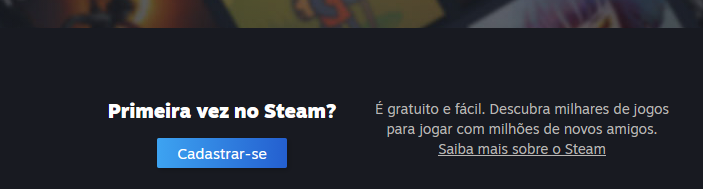

**Cadastrar com e-mail e senha**

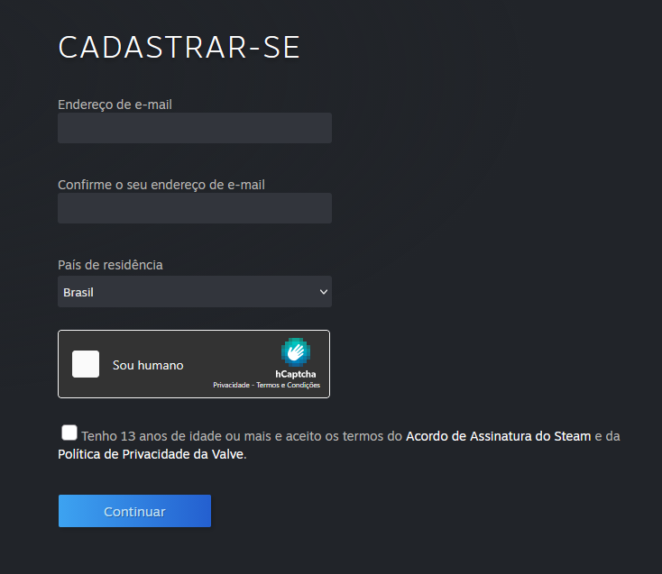

**Validação do e-mail (2018)**

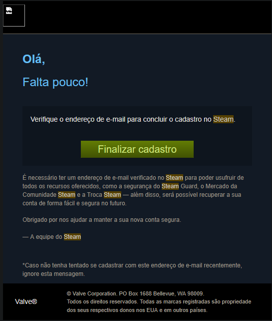

**Menu de configurações na página inicial**

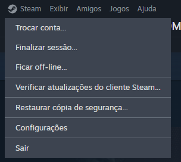

**Aba de Família e compartilhamento**

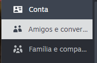

**Criar ou entrar em Família**

**Criar família**

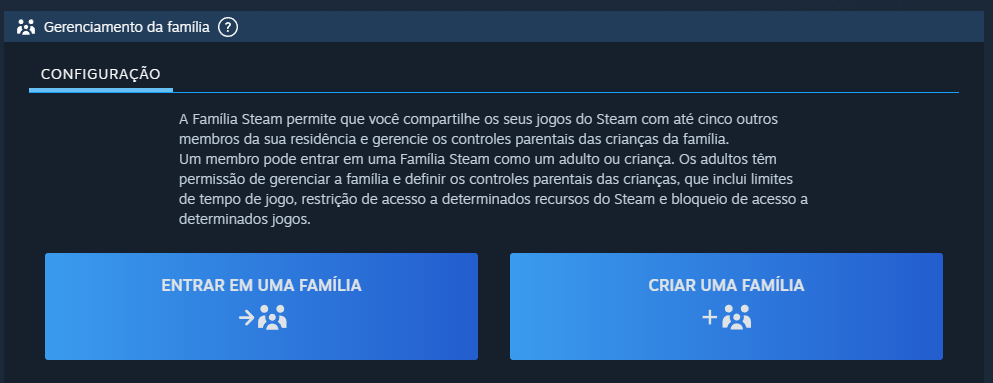

**Definição do nome**

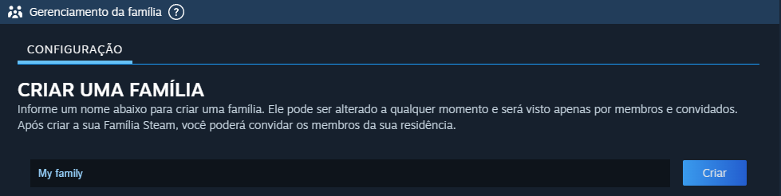

**Mensagem de erro (Conta Limitada)**

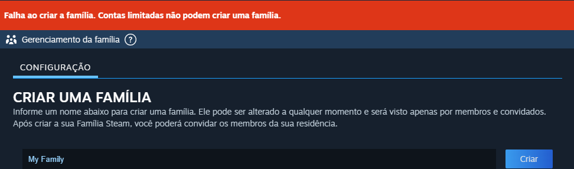

---

## 2. Saída e reentrada na mesma família (PASS)

*(Mesma sequência da anterior)*

**Família criada**

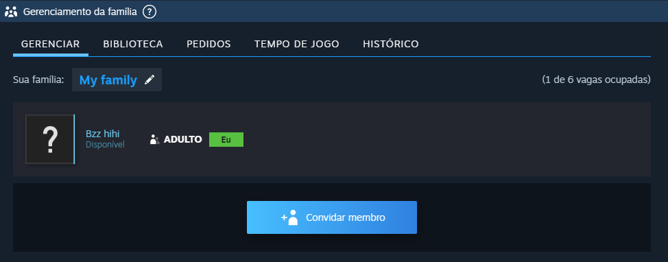

**Adicionando a outra conta como amigo**

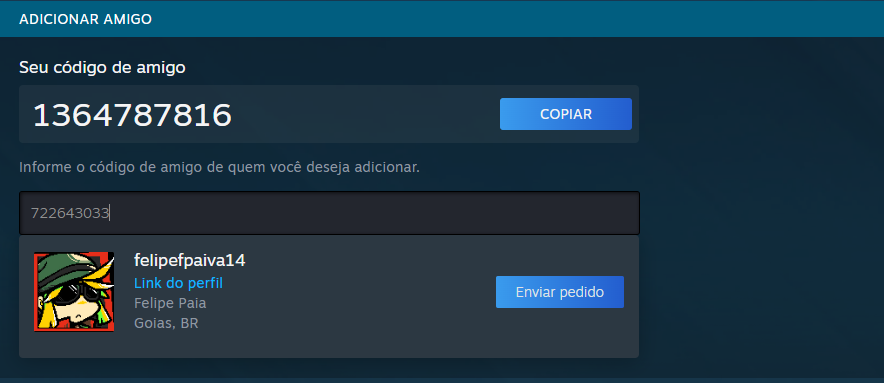

**Convidando a conta para a família (como adulto ou criança)**

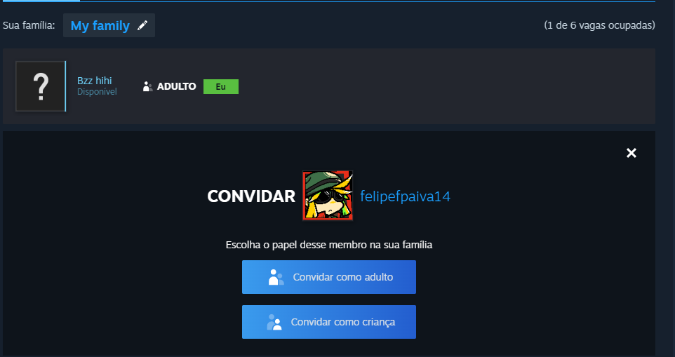

**Confirmação do convite**

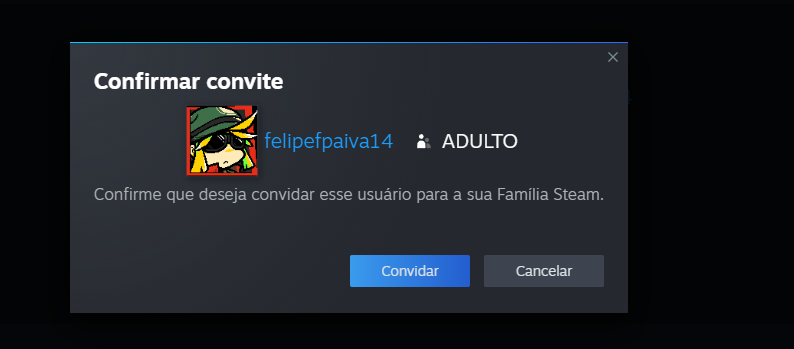

**Convite enviado**

**A outra conta recebe o convite**

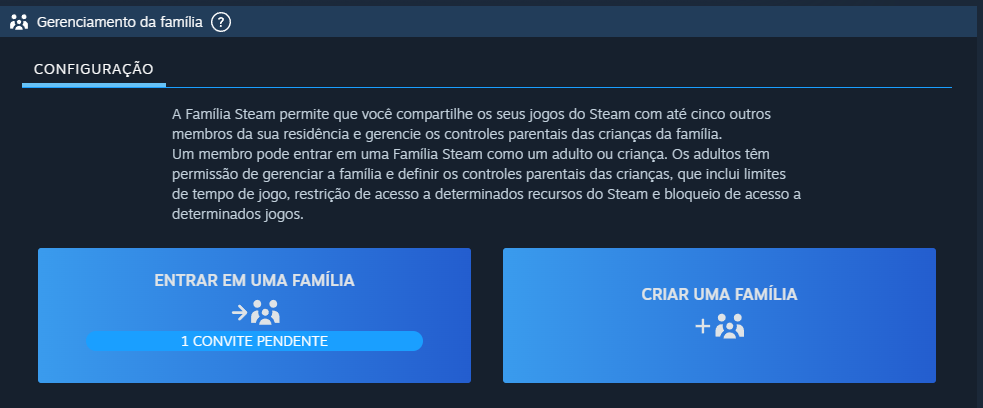

**Aceitar o convite (mostra avisos sobre não conseguir entrar em outra família durante um ano)**

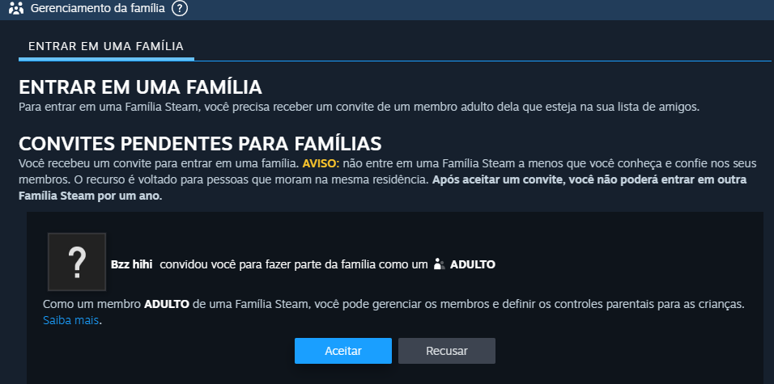

**Confirmação da entrada**

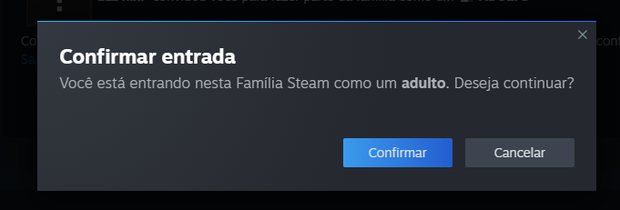

**Mensagem de solicitação da confirmação para o dispositivo móvel**

**Sair da família**

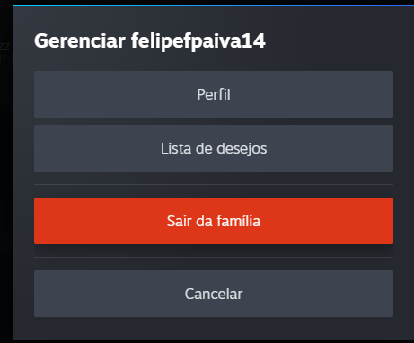

**Confirmação da saída da família**

**Quando há o convite novamente**

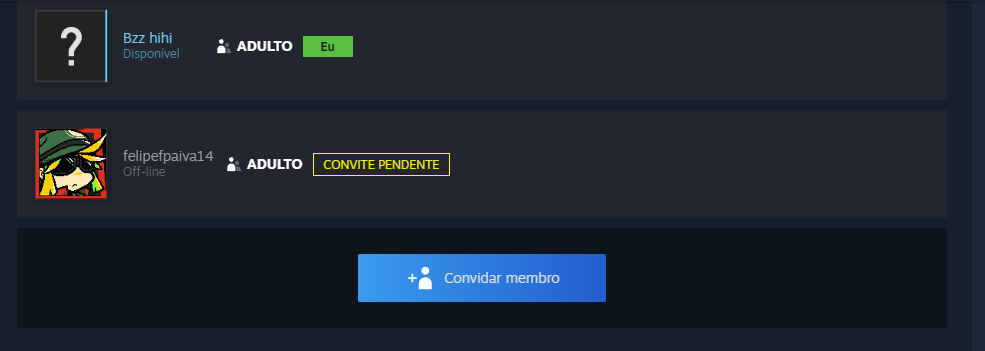

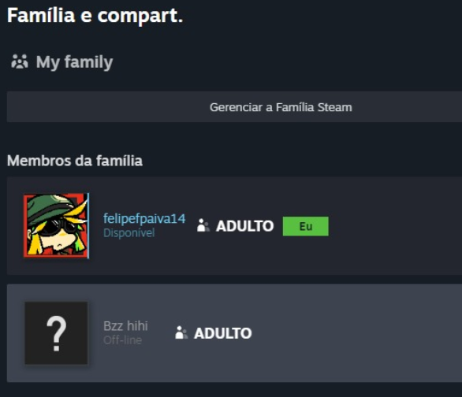

**Membro volta para a família (sem ter que esperar um ano)**

---

## 3. Mensagens no histórico de logs (PASS)

*(Mesma sequência da anterior)*

**No gerenciamento, ir à aba Histórico**

**Histórico com todas as alterações gerais da família**

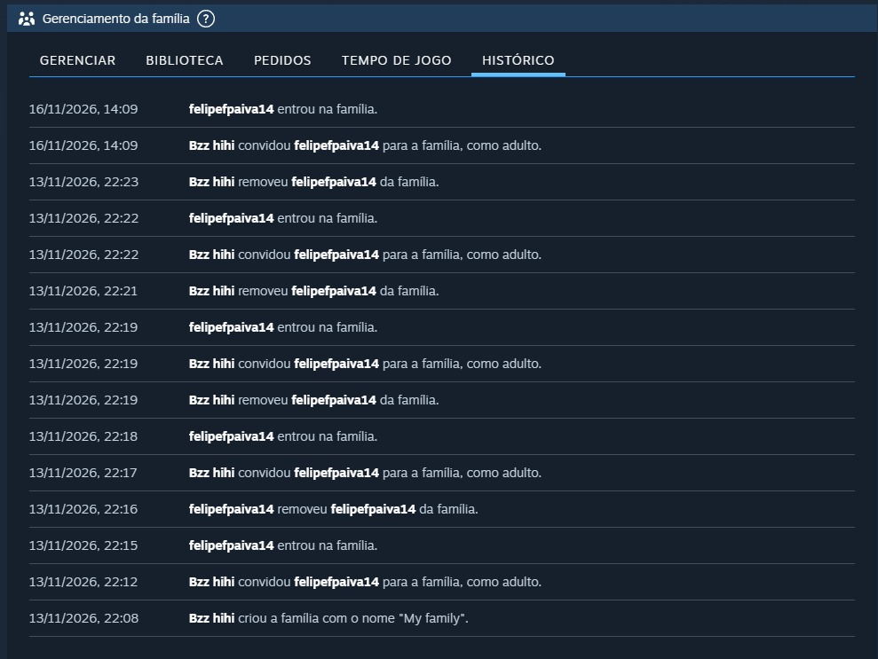

---

## 4. Abrir jogo de outro familiar (PASS)

*(Mesma sequência da anterior)*

**Minha família**

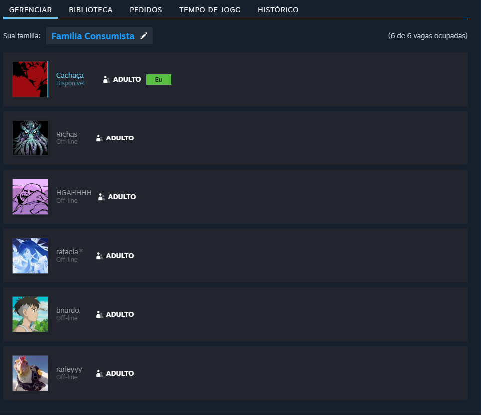

**Ir à página inicial da Biblioteca**

**Ir aos filtros**

**Filtro dos jogos da Rafaela**

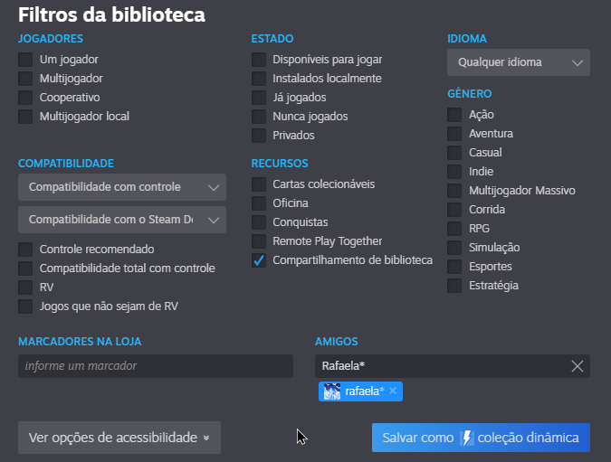

**Jogos que ela possui**

**Instalar jogo**

**Jogar**

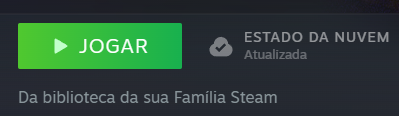

**Resultado esperado**

