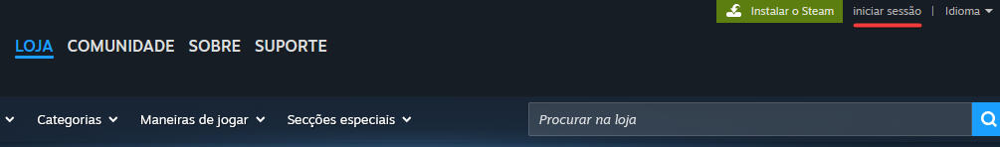
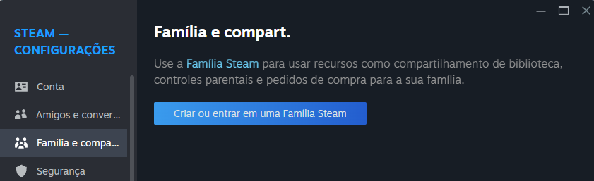
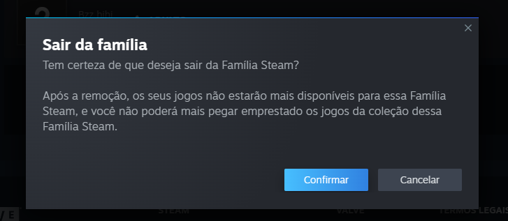
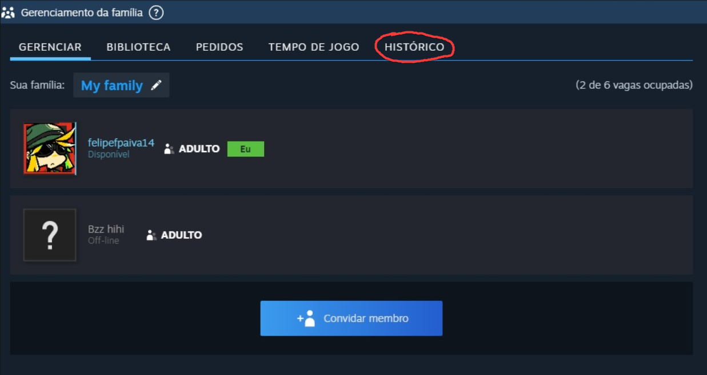
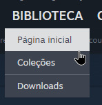
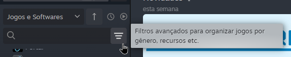
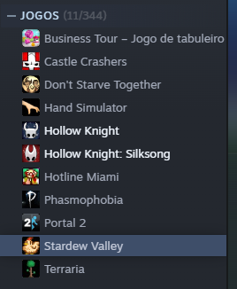
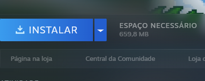
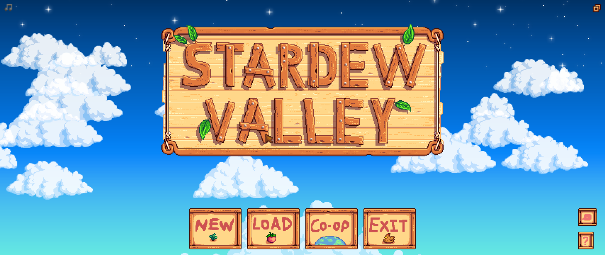

# Resultados dos Testes

## 1. Criação de família com conta limitada (PASS)  
  
Iniciar sessão  
  
  
Cadastrar-se  
  

Cadastrar com Email e senha  

Validação do email  (2018)

Menu de configurações na página Inicial  

Aba de Família e compartilhamento  

Criar ou entrar Família  

Criar família  

Definição do nome  

Mensagem de erro (Conta Limitada)  

## 2. Saída e reentrada na mesma família (PASS)

(Mesma sequência da anterior)

Criada a família

Adicionando a outra conta como amigo  

Convidando a conta pra família (como adulto ou criança)

Confirmação do convite

Convite enviado

A outra conta recebe o convite  
  

Aceita o convite (mostra avisos sobre não conseguir entrar em outra família durante um ano)  

Confirmação da entrada  

Mensagem de solicitação da confirmação para o dispositivo móvel  
  
Sair da Família  

Confirmação da saída da família

Quando há o convite novamente

Membro volta para família (sem ter que esperar 1 ano)

## 3. Mensagens no histórico de logs (PASS)

(Mesma sequência da anterior)

No gerenciamento, ir na aba Histórico

Histórico com todas alterações gerais da família feitas

## 4. Abrir jogo de outro familiar (PASS)

(Mesma sequência da anterior)

Minha família

Ir na página inicial da Biblioteca

Ir nos filtros

Filtro dos jogos da Rafaela 

Jogos que ela possui

  

Instalar jogo

Jogar

Resultado esperado

